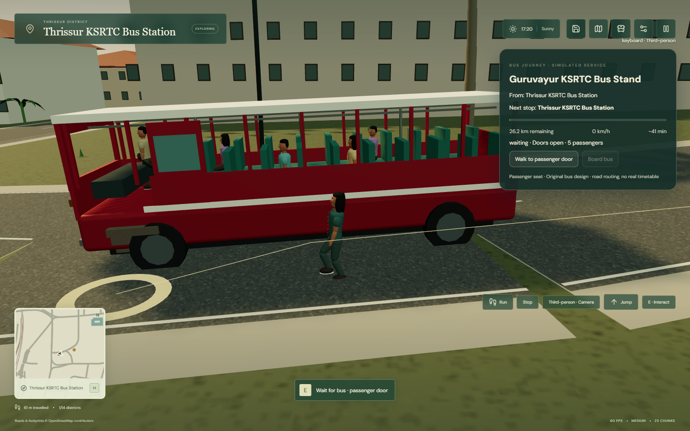
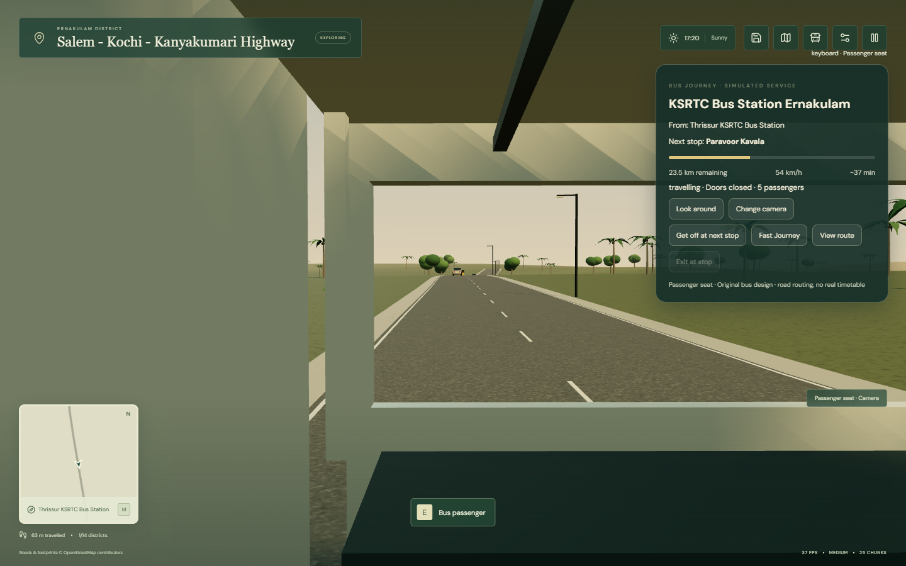
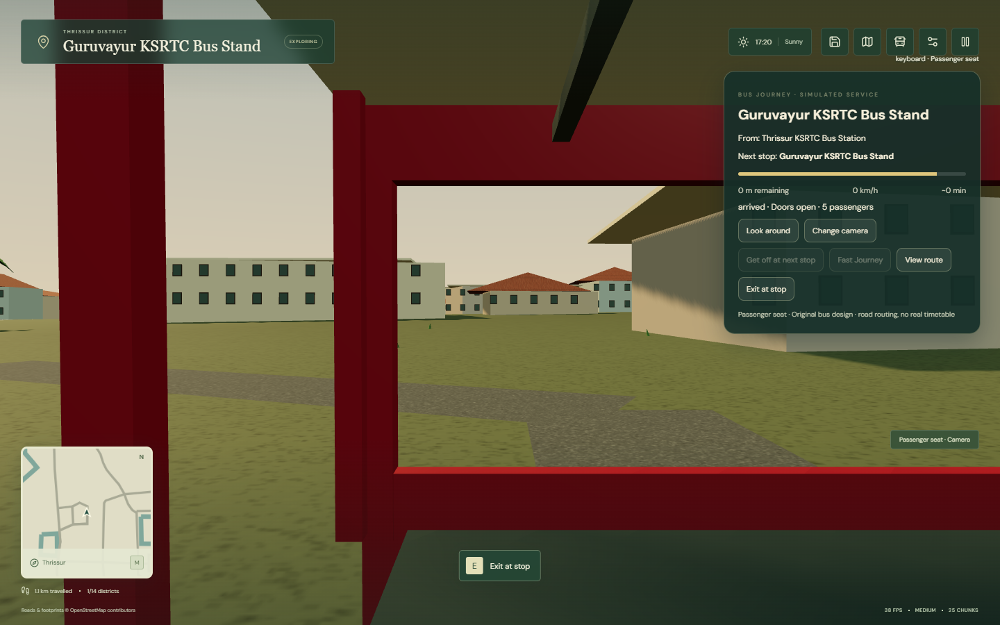

# Phase 8 implementation and verification

**Result:** the requested input, vehicle and passenger-transport systems are implemented in the existing React, TypeScript and Three.js game. The result is a playable, sourced exploration prototype. It does not meet an AAA or photorealistic target, and the mapped transport services are simulated game routes rather than claims about current public timetables.

## What changed

### Shared controls and interactions

Mouse, keyboard and browser gamepad input now feed the same movement and interaction actions. Input is filtered by gameplay context, and held actions clear when the player pauses, changes context, loses focus or disconnects a controller.

- On foot, the mouse can click or hold a ground destination, double-click to run, use the visible Run and Jump controls, right-drag to look, and use the wheel to zoom. UI clicks do not issue ground movement. Pathfinding and swept collisions keep movement around sourced buildings, vehicles, walls, water and terrain edges.
- In cars and motorcycles, holding the left mouse button accelerates, the right button brakes, and horizontal mouse motion steers with a dead zone, sensitivity, assistance and smoothing. HUD controls cover handbrake, reverse, exit and camera. A separate Look Around control keeps steering and camera orbit independent.
- Keyboard movement and remapping remain available. Gamepads support analog movement and camera input, driving triggers, button remapping, dead zones, menu focus, transport selection, pause and map controls. Disconnecting clears input. Vibration is used where the browser exposes it.
- A shared interaction manager serves mouse prompts, E, gamepad interaction, vehicles, people, terminals and public transport.

The browser test used a virtual standard-layout controller injected through the Gamepad API. No physical controller or vibration motor was available for this verification.

### Vehicles

Steering is progressive and speed-sensitive, returns toward neutral smoothly, and supports configurable sensitivity, dead zone and assistance. Braking stops without unintentionally selecting reverse; reverse is explicit. Mouse steering no longer turns the camera, and the camera has chase, close and hood views. Motorcycle lean, bus cornering, braking lights, wheel rotation, door motion and body pitch use the shared simulation.

This remains kinematic vehicle simulation with simplified collisions. Suspension, tire forces, rigid-body dynamics and fully animated entry/exit are not implemented. An interior car camera is omitted where the model has no suitable interior.

### Bus terminals and routes

The register contains **59 mapped bus-terminal records in all 14 districts**. Records can refer to separate mapped objects at one facility; this is not a count of 59 unique major terminals. It includes the sourced Thrissur KSRTC and private stands, Guruvayur, Kunnamkulam, Vyttila, Ernakulam, Aluva, Thampanoor and East Fort records. Each terminal uses an original Level C architectural interpretation with bays, shelter, signs, waiting seats, ticket and information counters, shops, lights, passenger activity and nearby auto-rickshaw parking. The layout is illustrative, not an exact reconstruction. Current operation and live schedules are not asserted.

Five in-game services use attributed OpenStreetMap road data and OSRM's **driving** routing profile. Route lengths are checked against imported geometry and each track has finite, connected vertices and sampled elevation coverage:

| Simulated service | Source distance | Route vertices |
|---|---:|---:|
| Thrissur–Guruvayur | 26.3 km | 914 |
| Vyttila–Aluva | 18.1 km | 533 |
| Thrissur–Ernakulam | 76.6 km | 2,890 |
| Kozhikode–Kannur | 92.4 km | 2,533 |
| Kottayam–Ernakulam | 66.9 km | 2,437 |

The route and stop names are sourced geographic data; vehicle timetables, fares and operating route numbers are not supplied. The road router does not certify bus legality, width, turning clearance or service availability. The audit samples lane-centre elevation and building/water footprint overlap. It identifies three water crossings on the longer routes that coincide with mapped bridges; bridge decks are not surveyed.

The passenger flow supports walking to the departure terminal, a bus approaching and stopping, a door prompt, boarding only while stopped with its door open, free-seat selection, door closure, continuous travel, intermediate dwell, requesting the next stop, safe exit and exploration afterward. Full Journey advances the bus along the route track. Fast Journey is a separate explicit transition and is recorded separately. Bus windows and passenger, window, exterior and forward cameras expose the trip scenery. The interior is a seat-selection experience: passengers cannot freely walk through the cabin, and the player's boarding uses a short transition rather than a detailed body animation.

### Geography, scenery and persistence

The imported register preserves 14 district boundaries, 3,435 place records, 181 railway-station records and four airports. The game now has **41 local areas**, five bus corridors and **46 elevation grids**. Local terrain is sampled at 80 m, and bus corridors at 160 m, from attributed Mapzen / Tilezen HGT terrain. Triangular interpolation makes physics heights match the rendered terrain. OSM horizontal coordinates remain unchanged.

The fidelity register separates geographic evidence from appearance: sourced coordinates or footprints are Level B; original procedural landmark and terminal models are Level C. No Level A reconstruction is claimed. Source and license details are in [the data notice](public/data/NOTICE.md); machine-readable inventories are [the fidelity register](public/data/fidelity-register.json), [geographic validation](public/data/validation-report.json), [terrain index](public/data/terrain-index.json) and [bus route audit](public/data/bus-route-audit.json).

Local train segments support passenger boarding, three camera views, requested station stops and safe exit on imported track alignments. Statewide rail transfers and airport transfers still use scene transitions; continuous statewide train or aircraft rides are not implemented.

Save format version 2 stores avatar, position, controls, camera, discoveries, station visits and journey history, and migrates version 1. An in-progress bus or train save resumes on foot at its last safe checkpoint instead of inside a moving vehicle or unloaded area.

## Verification results

All required project commands completed successfully on 23 October 2026:

| Check | Result |
|---|---|
| `npm run build` | TypeScript and production Vite build passed. |
| `npm test` | **51 passed, 0 failed.** Includes control state, driving, routing, save migration, bus/rail journeys, collisions, terrain and geographic validation. |
| `npm run data:validate` | Passed for 14 districts, 59 bus records and all five route registries; all corridor elevation samples were present. |
| `npm run test:browser` | **15 of 15 workflows passed.** See [suite results](output/playwright/suite-results.json). |

The browser suite checks both avatars, mouse and keyboard movement, collisions, camera behavior, vehicle controls, controller input and menus, all 14 district arrivals, 13 extra local areas, settings, narrow layouts, map navigation, moving NPCs, traffic and track audits, bus stops, rail stops, saves and longer journeys. Its virtual gamepad covers the controls through the browser API; it is not a hardware test.

The Thrissur–Guruvayur full-trip test started from the normal Thrissur spawn, used mouse ground navigation to walk approximately **1.08 km** to the KSRTC station, boarded a seat, travelled about **26.3 km** through the normal simulation, observed mapped stop dwell phases and reached the Guruvayur station. It did not use Fast Journey. A separate requested-stop test held at Muthuvara and verified safe on-foot restoration after reload.

The cross-district Thrissur–Ernakulam coach test followed the **76.6 km** track in Full Journey mode, reported both Thrissur and Ernakulam, used up to 25 active chunks, arrived at Ernakulam KSRTC and exited without a blocked spawn. Both long browser checks use a development-only deterministic clock to advance the same simulation at fixed substeps; their clock is accelerated and is not a real-time speed or FPS claim.

The district and moving-route browser audits found no blocked initial district spawns, no off-road or wrong-side traffic in the reviewed scene, no blocked visible pedestrian in that audit, and no train off its imported track. Those checks cover the tested scenes and do not certify every possible route.

## Performance sample and limits

A separate 180-frame requestAnimationFrame sample ran after a two-second warm-up in headless Chromium 155 on Windows, at 1440 × 900 in the Thiruvananthapuram scene. The machine's GPU was not recorded.

| Preset | Mean FPS | P95 frame | Frames over 50 ms | Draw calls | Triangles | Active chunks |
|---|---:|---:|---:|---:|---:|---:|
| Medium | 60.35 | 16.8 ms | 0 | 403 | 206,328 | 25 |
| Low | 60.09 | 16.8 ms | 0 | 317 | 136,098 | 9 |

These are short, stationary, headless-browser samples capped by requestAnimationFrame. They are not a 4 GB laptop benchmark. The cross-district streaming sample held at 25 chunks and disposed old chunks as it advanced, but sampled JavaScript heap usage reached around **402 MB** and the slowest measured chunk build was **87.2 ms**. That is a visible-stutter risk during dense streaming. It should be improved before treating the result as production-ready. GPU memory and longer repeated-session stability were not measured.

The bundled `public/data` directory is about 50 MB. Source and import caches in `output/phase8-source` are larger and support reproducible local imports. Browser captures for this run are in `output/playwright/phase8-suite/`.

## Representative screenshots

Additional district, terminal, camera, performance and route screenshots are saved alongside these files in the browser capture directory.

## Files

**New gameplay modules:** `src/game/gamepad.ts`, `bus.ts`, `busModels.ts`, `busSpecs.ts`, `interactions.ts`, `rail.ts`, `terrain.ts`, `terminals.ts` and `vehicle.ts`.

**New geographic and audit tooling:** `scripts/import_phase8.py`, `import_corridor_scenery.py`, `import_terrain.py`, `prepare-bus-tracks.ts` and `audit-bus-routes.ts`. Generated data includes `public/data/bus-services.json`, five `bus-route-*.json` tracks, mapped `bus-*.json` terminal tiles, 46 `elevation-*.json` grids, `terrain-index.json`, `fidelity-register.json` and `bus-route-audit.json`. Cached source responses are under `output/phase8-source/`.

**New tests:** `tests/phase8.test.ts`, `input.test.ts`, `rail.test.ts`, `terrain.test.ts`, and browser workflows for mouse driving, gamepad, Phase 8, bus stops, full and inter-district journeys, and rail. `scripts/browser-suite.ps1` runs the browser workflows; screenshot paths now use a dedicated directory so checks do not overwrite existing captures.

**Modified application and existing data:** `src/App.tsx`, `src/data/geography.ts`, `src/game/assets.ts`, `audio.ts`, `engine.ts`, `input.ts`, `navigation.ts`, `save.ts`, `traffic.ts`, `world.ts`, `src/types.ts`, `src/styles.css`, and the `src/ui/` game, settings, transport and map components. Existing geography, validation, browser scripts and tests were extended. `package.json`, `README.md`, `public/data/NOTICE.md`, `extra-areas.json`, `places.json`, `regions.json` and `validation-report.json` were updated.

## Remaining work

Scenery and terminal architecture are stylized procedural approximations. Terrain is coarse; building, roadway and bridge heights are not survey data. Bus tracks use an OSM driving route and do not establish a lawful or currently operated bus service. Bus and NPC behavior is lightweight, and normal simulated traffic lights are not a comprehensive junction model. Rail and aircraft travel are only partly continuous. The game has no physical-controller hardware run, GPU memory measurement, exhaustive all-road collision audit, full statewide seamless walkable terrain, online save, or deployment. The captured **87 ms chunk build** is the clearest measured performance issue left for a later pass.
